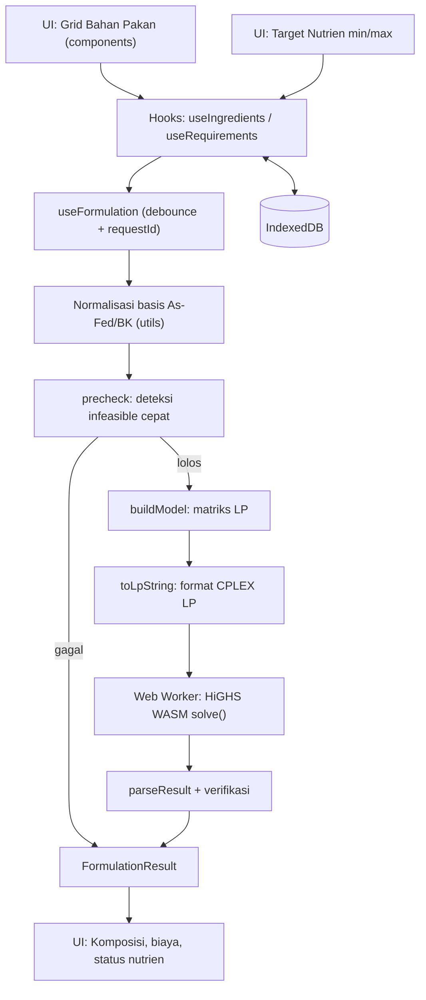
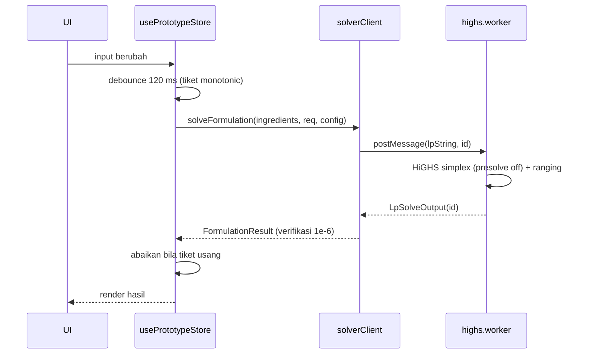

# Arsitektur OpenFormu

## Prinsip

1. **Client-side only** — tidak ada backend; solver berjalan di browser.
2. **Offline-first** — semua aset di-cache Service Worker, data di IndexedDB.
3. **Domain murni** — `src/solver` dan `src/utils` bebas React sehingga mudah diuji.

## Alur Data

## Urutan Eksekusi Solve

## Modul

| Folder           | Tanggung jawab                                                                                                                                                                                                                                                                                                                                                                                                                                                                                                                                                                                                                                                                                                                                                                                                                                                                                                                                                                                                                                                                                                                                                                                                                                                                                                                                                                                                                                                                            |
| ---------------- | ----------------------------------------------------------------------------------------------------------------------------------------------------------------------------------------------------------------------------------------------------------------------------------------------------------------------------------------------------------------------------------------------------------------------------------------------------------------------------------------------------------------------------------------------------------------------------------------------------------------------------------------------------------------------------------------------------------------------------------------------------------------------------------------------------------------------------------------------------------------------------------------------------------------------------------------------------------------------------------------------------------------------------------------------------------------------------------------------------------------------------------------------------------------------------------------------------------------------------------------------------------------------------------------------------------------------------------------------------------------------------------------------------------------------------------------------------------------------------------------- |
| `src/types`      | Tipe domain kanonik                                                                                                                                                                                                                                                                                                                                                                                                                                                                                                                                                                                                                                                                                                                                                                                                                                                                                                                                                                                                                                                                                                                                                                                                                                                                                                                                                                                                                                                                       |
| `src/data`       | Sampel bahan JSON, klasifikasi 8 kelas pakan (`feed-classes`), **22 standar SNI bertahun terbit** & **17 standar unggas NRC 1994** (`sni-requirements`), dataset kerja (`mock-state`), **344 bahan** terkalibrasi bebas-duplikat Hartadi 1980 + Kearl 1982 + NRC 1994 (`hartadi-feeds`), **98 profil** Kearl 1982 (Sapi, Domba, Kambing, Kerbau) & **24 profil** NRC 1988 (`kearl-requirements`)                                                                                                                                                                                                                                                                                                                                                                                                                                                                                                                                                                                                                                                                                                                                                                                                                                                                                                                                                                                                                                                                                                                                                                                                              |
| `src/solver`     | `precheck`, `buildModel`, `toLpString`, `parseResult`, `solveFormulation`, `highs.worker`, `solverClient`, `iis`, `criticalStepping`, `enzymes`, `stochastic`, `rumenEvaluator`, `ingredientAdvisor` (rekomendasi bahan prioritas Indonesia)                                                                                                                                                                                                                                                                                                                                                                                                                                                                                                                                                                                                                                                                                                                                                                                                                                                                                                                                                                                                                                                                                                                                                                                                                                              |
| `src/storage`    | `db` (IndexedDB `idb` `openformul-db` v1 + merge non-destruktif preset SNI baru), `recipeTransfer` (`.feed.json`), `exportCsvXlsx` (CSV BOM & OOXML `.xlsx` 4-sheet formulasi + 2-sheet database 25 nutrien), `exportPdf` (PDF 1.4 ber-`Head Kop` & `Tail Kop` 3 kolom otorisasi: formula lengkap, lembar timbang gudang 2-versi `xx,xxx` & bulat, katalog bahan, & resep)                                                                                                                                                                                                                                                                                                                                                                                                                                                                                                                                                                                                                                                                                                                                                                                                                                                                                                                                                                                                                                                                                                                                                                                                                            |
| `src/i18n`       | Kamus & helper bilingual `ID / EN` (`pickLang`, label kategori/spesies/status/tier, terjemahan diagnostik konflik & IIS)                                                                                                                                                                                                                                                                                                                                                                                                                                                                                                                                                                                                                                                                                                                                                                                                                                                                                                                                                                                                                                                                                                                                                                                                                                                                                                                                                                  |
| `src/utils`      | `basis` (As-Fed ↔ BK termasuk skala `stdDev` & `phytateP`), `equations`, `cattle-requirements` (kalkulator dinamis sapi potong/perah Kearl 1982 & NRC 1988 dengan `dynamicCalculation` 2 desimal), `validators`, `ingredientCsvImport`, `tsvPaste`, `download`, `external-link` (opener tautan browser OS pada runtime Tauri), `locale-number`, `cn`                                                                                                                                                                                                                                                                                                                                                                                                                                                                                                                                                                                                                                                                                                                                                                                                                                                                                                                                                                                                                                                                                                                                      |
| `src/hooks`      | `usePrototypeStore` (orkestrasi solve live, hidrasi & persistensi IDB, non-destructive `loadRecipe`), `usePwaStatus`                                                                                                                                                                                                                                                                                                                                                                                                                                                                                                                                                                                                                                                                                                                                                                                                                                                                                                                                                                                                                                                                                                                                                                                                                                                                                                                                                                      |
| `src/theme`      | Sistem multi-tema **5 palet kurasi × Light/Dark/AMOLED (15 varian)** dengan **3 Mode UI (`UiMode`: `Biasa`, `Enhanced` [default], `Anti-Slop`)** via `use-theme.ts` (`openformu-ui-mode` + migrasi kunci lama `openformul-ui-mode` / `openformu-theme-enhancer` / `openformul-theme-enhancer`, atribut DOM `data-ui-mode` & `data-ui-enhancer`, serta hidrasi pra-lukis di `index.html`) + profil **Rendering & Motion Engine** ringkas (`Smooth (120 FPS)` vs `Standard (Biasa)`), stylesheet terisolasi `anti-slop.css` (`[data-ui-mode="anti-slop"]` terkalibrasi WCAG AA, lihat [anti-slop-design-direction.md](anti-slop-design-direction.md)), (`themes.css`, `neumorphism-shadows.css`, `mobile-adaptive.css` termasuk padding atas/bawah `.safe-area-header`, aturan landscape Android & `--android-inset-*`, `palettes.ts`, `ThemeProvider.tsx`), sinkronisasi `<meta name="theme-color">` & manifest (`pwa-theme-sync.ts`), serta jembatan status bar/navigasi & `WindowInsets` native Android (`android-theme-bridge.ts` dengan polaritas mode Terang `biasa`=`primaryHex` vs `enhanced`/`anti-slop`=`canvasHex` ↔ `OpenFormulSystemBars` di `MainActivity.java`)                                                                                                                                                                                                                                                                                                              |
| `src/components` | UI presentasional lintas 3 mode tampilan: mode `Enhanced` berlapis **3-Layer Acrylic Glass** (`backdrop-filter: blur + saturate(165%)`, _specular rim light_ `1.2px`, bayangan berwarna palet), mode `Biasa` solid klasik, dan mode `Anti-Slop` terisolasi permukaan datar WCAG AA tanpa blur/glow dengan state Empty/Loading/Error lengkap di seluruh 6 rute (tanpa regresi pada `Biasa` & `Enhanced`), `AppShell` skip-link `#main-content` & landmark `<main>`, sidebar dengan logo squircle halus `logo-squircle.png`, tombol utama `Formulasi Ransum` 1,5x + _glowing pill_ & `TrakteerSupportButton` (`surface="adaptive"` agar tetap terbaca pada drawer tema terang), `SheetDialog` dengan focus-trap & pemulihan fokus trigger, `ThemedSelect` & kontrol sentuh `>= 44px` di mobile, gelombang kaca kanan atas (`Enhanced`), _zero-hardcut_ `AnimatedTextSwap`, tabel split Bahan Digunakan vs Semua Bahan, `IngredientMobileCards` kisi 4×2 + input `Harga/kg`, `Min %`, `Max %` permanen, meter kedekatan Target Nutrien (`computeNutrientProximityMeter`), `NutrientTargetsPanel` dengan tombol `0,00` & `Rincian Hitung` dinamis, ringkasan `Capaian Nutrien Hasil Formulasi` di `ResultsPanel`, kartu mobile `ShadowPriceTab`, `ThemeSwitcherMenu` stepper `<` `>` 5 palet & pemilih radio 3 Mode UI (`Biasa`, `Enhanced`, `Anti-Slop`), `SettingsPage` 2 opsi Engine (`Smooth` vs `Standard`) + cek update GitHub `OpenFormu`, serta font offline `@fontsource-variable/*` |

## Offline, PWA & Deploy Lintas Platform (Fase 4)

- `vite-plugin-pwa` (`mode: "generateSW"`, `registerType: "autoUpdate"`) dengan `base` dinamis via `VITE_BASE_PATH` (`/OpenFormu/` di GitHub Pages, `/` di lokal/root), `start_url: "./"`, `scope: "./"`, `public/manifest.webmanifest` beserta `pwa-theme-sync.ts` (pembaruan reaktif `<meta name="theme-color">`, `apple-mobile-web-app-status-bar-style`, & Blob manifest), dan `maximumFileSizeToCacheInBytes: 6 * 1024 * 1024` untuk _precache_ aset statis serta `highs-*.wasm`.
- **Instalasi Desktop & Mobile (`usePwaStatus.ts`):** Menangkap `beforeinstallprompt` dan menyediakan tombol instalasi native di `AppShell` dan `SettingsPage` + bundel portabel di GitHub Releases.
- **Aplikasi Native PC `.exe` & Android `.apk`:** Selain PWA web, repositori dibungkus dengan **Tauri v2** (`src-tauri/`, diluncurkan `maximized: true` dengan `tauri-plugin-opener` agar tautan eksternal terbuka di browser OS) untuk installer Windows NSIS (`.exe`) dan **Capacitor 8** (`android/`, `capacitor.config.json`, `MainActivity.java`, `AndroidManifest.xml`, `android/app/src/main/res/values/colors.xml`, `styles.xml`, & `values-v28/styles.xml`) dengan edge-to-edge `WindowCompat.setDecorFitsSystemWindows(false)`, cutout `shortEdges`, penerusan `WindowInsets` (`--android-inset-*`), dan jembatan status bar/navigasi dinamis (`android-theme-bridge.ts` ↔ `OpenFormulSystemBars`) menggunakan script `npm run build:native` (`mode === "native"`). Ekspor file di [download.ts](../src/utils/download.ts) otomatis memilih dialog Save As (`@tauri-apps/plugin-dialog` + `@tauri-apps/plugin-fs`), Android Share/Filesystem (`@capacitor/filesystem` + `@capacitor/share`), atau Blob web sesuai runtime.
- IndexedDB via `idb` (`openformul-db` v1) dengan 5 object store: `ingredients`, `requirements`, `recipes`, `active_session`, dan `preferences` (beserta fallback memori aman jika IndexedDB diblokir/tidak tersedia).
- **Modul Lanjutan (`AdvancedModulesPreview.tsx`):** Menyediakan 5 kartu pintasan aktif ramah peternak yang langsung mengarahkan ke fitur live (`ShadowPriceTab`, `WhatIfManualLock`, `PrecisionEngineDialog`) serta 3 rencana pengembangan pasif tanpa jargon teknis internal (pemetaan riset lengkap `PR-01` s/d `EN-05` tetap didokumentasikan di [advanced-feature-research-plan.md](advanced-feature-research-plan.md)).
